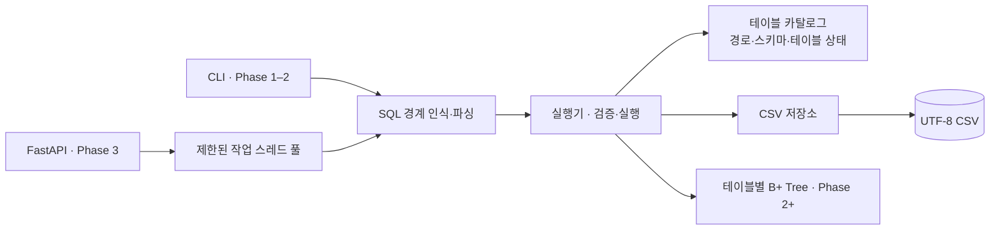
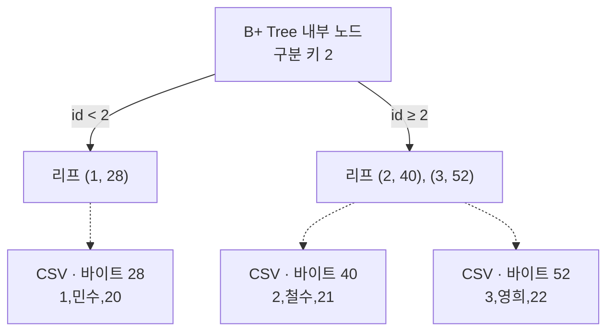
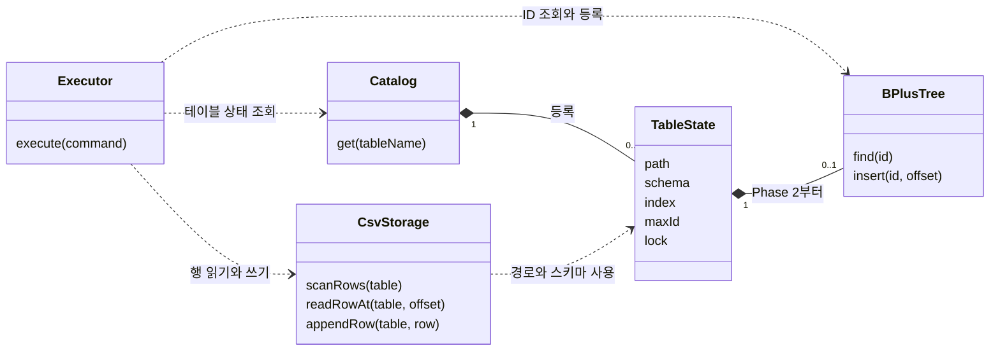
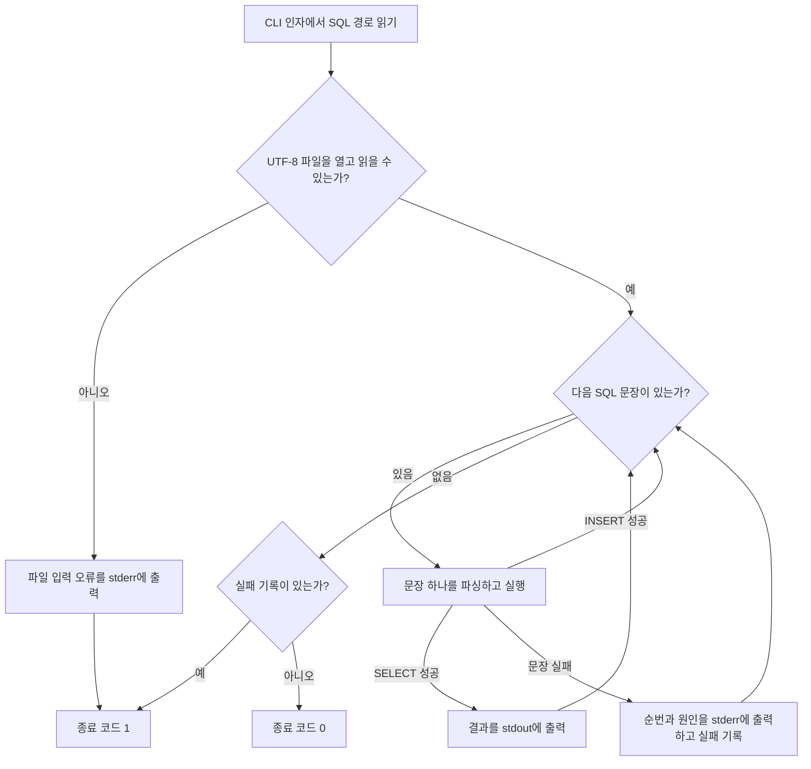
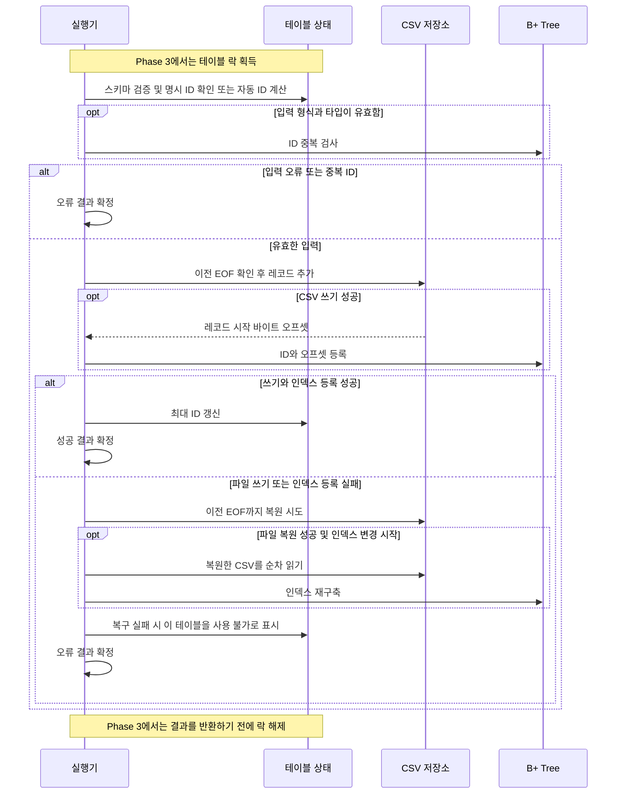
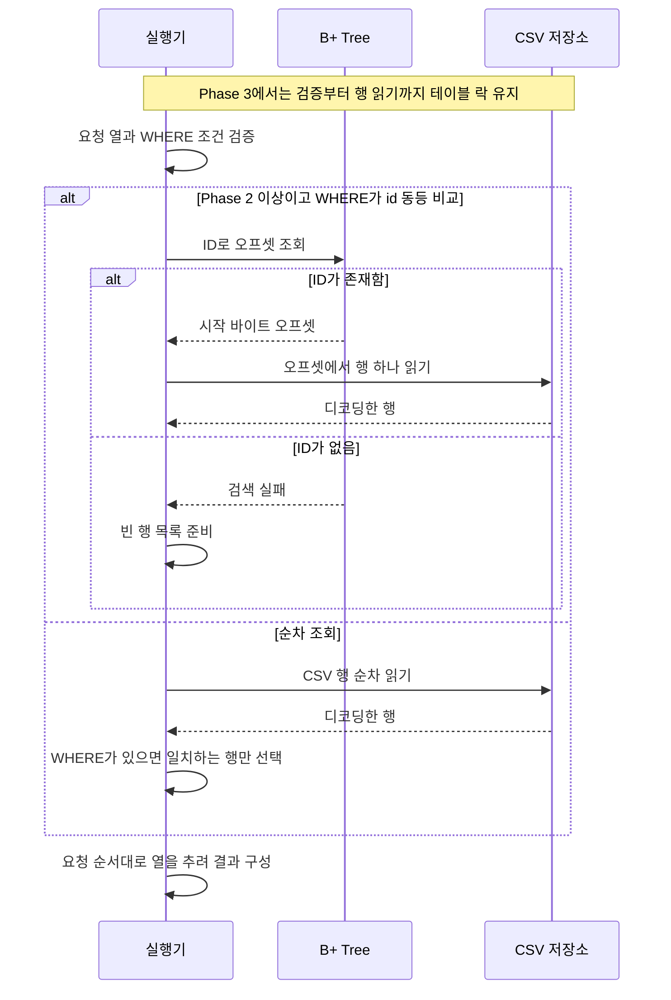

# ARCHITECTURE.md

# Development Rules

- SQL 파서와 실행기를 공통으로 두고, CSV를 재시작 후에도 남는 데이터의 기준으로 삼는다.
- Phase 1은 CLI에서 읽고 쓴다.
- Phase 2는 같은 CSV에 B+ Tree를 연결한다.
- Phase 3은 같은 실행기를 FastAPI에서 호출하고 테이블별 락으로 공유 상태를 보호한다.
- 인수 기준은 `REQUIREMENTS.md`를 따른다.

# 구성 요소



| 구성 요소 | 책임과 경계 |
| --- | --- |
| CLI | 인자로 받은 UTF-8 SQL 파일에서 문장을 순서대로 읽는다. 결과는 stdout, 문장 순번과 오류 원인은 stderr로 보낸다. |
| 파서 | 문자열 바깥의 세미콜론으로 문장을 나눈다. 한 문장에서 `Insert(table, columns?, values)` 또는 `Select(table, columns, where?)`를 만든다. |
| 실행기 | 카탈로그로 테이블을 찾고 스키마를 검증한다. 삽입, 투영, 동등 비교와 조회 경로를 결정한다. `Inserted(id)` 또는 `Selected(columns, rows)`를 돌려준다. |
| 카탈로그 | 설정된 테이블명과 CSV 경로를 연결한다. 테이블 상태에 스키마와 Phase 2의 인덱스, 최대 ID, Phase 3의 락을 둔다. |
| CSV 저장소 | 헤더 검증, 행 직렬화/역직렬화, 순차 읽기, 행 추가, 바이트 오프셋 조회를 담당한다. |
| B+ Tree | 정수 `id → 시작 바이트 오프셋` 매핑의 삽입과 점 조회를 제공한다. 파일은 실행기와 저장소를 통해 접근한다. |
| API | JSON 입력과 길이, SQL 한 문장 제한을 검증하고, 실행 결과와 오류를 HTTP 응답으로 변환한다. |

# Data Structures

| 자료구조 | 보관하는 값 | 사용하는 곳 |
| --- | --- | --- |
| SQL 명령 | `Insert(table, columns?, values)`, `Select(table, columns, where?)`. 조건은 열 이름과 동등 비교에 쓸 값이다. | 파서에서 실행기로 넘긴다. |
| 카탈로그와 스키마 | 테이블명으로 등록 경로와 상태를 찾는다. 스키마는 순서가 있는 열 이름과 타입의 목록이다. | 실행기가 입력 검증, 행 배치, 결과 열 선택에 사용한다. |
| CSV 테이블 | 헤더 한 줄과 데이터 행. 각 행은 스키마 순서로 저장한다. | 저장소의 순차 읽기와 행 추가에 사용한다. |
| B+ Tree | 내부 노드는 구분 키와 자식 참조를, 리프는 `(id, 바이트 오프셋)`을 보관한다. | Phase 2부터 ID로 CSV 행의 시작 위치를 찾는다. |
| 테이블 상태 | 스키마·경로, Phase 2의 인덱스·최대 ID, Phase 3의 락을 보관한다. | 같은 테이블 요청끼리 상태를 공유한다. |
- 아래 예시는 헤더가 `id:int,name:string,seat:int` 인 UTF-8파일 예시이다.
    - LF 줄바꿈을 포함하면 헤더는 28바이트, 예시 행은 각각 12바이트다.
    - 파일의 40번 바이트로 이동하면 ID 2의 행부터 읽을 수 있다.



# Class Diagram



- 코어 상태의 소유 관계를 그린 설계안이다.
- `Executor`와 `CsvStorage`는 책임을 나타내는 이름이다.
- 구현에서 상태가 필요 없는 동작은 모듈 함수로 둘 수 있다.

# Entity-Relationship Diagram

> **현재 범위의 CSV 테이블은 각각 독립적이며 테이블 간 관계나 외래 키는 정의되어 있지 않다.**
> 
- **예약 등의 예시 도메인에 테이블 간 관계가 생기면 해당 도메인 설계에 ERD를 추가한다.**
- **현재 엔진에서 구현할 구조는 위의 자료구조와 클래스 다이어그램으로 설명한다.**

# Flow Chart



- CLI는 문장 하나가 실패했을 경우 이를 기록하고 다음 문장으로 넘어간다.
- 최종 종료 코드는 SQL 파일 전체의 실행 결과를 나타낸다.

# Sequence Diagram

### INSERT - 파일 쓰기/인덱스 갱신



### SELECT - 조회 경로 선택



# 기능 별 설계

## Phase 1. SQL, CLI, CSV Storage

### SQL 계약

> **SQL문을 읽고 해석하여 처리한다**.
> 

| 입력 | 동작 |
| --- | --- |
| `INSERT INTO t VALUES (...);` | 스키마 순서대로 값 하나씩 받는다. |
| `INSERT INTO t (col, ...) VALUES (...);` | 열과 값의 개수가 일치해야 한다. 중복·미등록 열을 거부한다. Phase 1 설계안은 모든 열을 한 번씩 지정하도록 하고, 순서가 다르면 스키마 순으로 재배치한다. Phase 2부터 ID 생략을 허용한다. |
| `SELECT * FROM t;` / `SELECT col, ... FROM t;` | 전체 열은 스키마 순서로, 명시된 열은 요청 순서로 반환한다. 결과가 없으면 열 목록과 빈 행 목록을 반환한다. |
| `WHERE col = literal` | 조건이 없으면 모든 행을 읽는다. 조건이 있으면 존재하는 열에 대해 스키마 타입의 값으로 비교한다. |
- 키워드는 대소문자를 구분하지 않는다.
    - 설계안은 식별자를 영문, 숫자, 밑줄로 제한하고 첫 글자는 영문 또는 밑줄로 둔다.
    - 테이블명과 열 이름은 카탈로그와 헤더의 표기를 그대로 사용한다.
- 정수와 작은따옴표 문자열을 구분한다. 설계안은 부호 있는 10진 정수와 SQL의 작은따옴표 두 개(`''`)를 지원한다.
    - 예를 들어 `'O''Brien, 민;수'`는 문자열 값 하나다.
    - 공백과 줄바꿈은 토큰 사이에서 허용한다.
    - 값 내부의 CR/LF는 거부한다.
- 파서는 한 문장의 입력을 끝까지 소비한다.
    - 지원하지 않는 절이나 여분의 토큰이 있으면 구문 오류다.
    - 설계안은 마지막 세미콜론을 요구하고, 공백만 있는 구간이나 빈 문장은 순번에서 제외한다.
- CLI는 문장을 하나씩 파싱하고 실행한다.
    - 경계를 찾을 수 있는 문장의 구문 오류나 실행 오류는 기록하고 다음 문장을 처리한다.
    - 닫히지 않은 따옴표가 파일 끝까지 이어지면 남은 구간을 한 문장의 오류로 보고한다.
    - 문자열 내부 세미콜론을 문장 경계로 다시 해석하면 의도하지 않은 SQL을 실행할 수 있다.
- CLI 종료 코드 설계안은 전체 성공 `0`, 파일 입력 오류 또는 문장 하나 이상 실패 `1`이다.
- 출력은 SELECT마다 헤더와 행을 CSV 형식으로 쓴다.
- 앞에서 성공한 문장의 변경은 개별 문장 실패 후에도 남는다.

### CLI 입력

> CLI 가 입력을 받고 실행을 제어한다. Phase 1, 2에서만 사용하고 Phase 3에서는 API가 대신한다.
> 
- 명령줄 인자로 SQL 파일 경로를 받는다.
    - `./query.sql`은 입력 예시다.
    - 상대 경로는 CLI를 실행한 디렉터리를 기준으로 해석한다.
- CLI는 SQL 파일을 UTF-8로 열고, 파서가 문장 단위로 파싱 결과를 실행기에 넘긴다.
    - 파일이 없거나 읽을 수 없으면 파일 오류를 보고한다.
    - 개별 문장의 오류 처리, 출력은 위 SQL 계약을 따른다.
- 테이블 카탈로그는 준비된 테이블 디렉터리의 CSV 경로를 관리한다.
    - `./tables`는 디렉터리 예시다.
    - SQL 파일 위치와 테이블 경로 설정은 독립적이다.

### CSV 저장소

- 카탈로그에 미리 등록된 테이블명으로만 경로를 조회한다.
    - 저장소는 기존 파일을 연다.
    - 설정된 CSV 경로는 링크를 해소한 뒤 테이블 디렉터리 내부인지 확인한다.
- **첫 줄은 스키마**, 이후에는 **물리적 한 줄에 레코드 하나**를 둔다.
    - 기본 헤더 설계안은 `id:int,name:string,seat:int`같이 설계하며 `:` 양 옆의 공백을 허용한다.
    - 각 열은 `int`또는 `string`타입을 명시하고, `id`는 정수형 열 하나로 둔다.
    - Python 표준 라이브러리 `csv`로 쉼표와 큰따옴표를 처리한다.
- CSV 파일 형식은 UTF-8, 개행은 LF로 쓴다.
    - 마지막 줄에 구분 개행이 없으면 다음 행을 추가하기 전에 개행을 넣는다.
- 중복된 헤더 이름, 지원하지 않는 타입, 잘못된 인용/인코딩, 스키마와 다른 행 너비나 타입은 **저장소 오류**로 보고한다.
    - 읽을 때도 필드 내부 줄바꿈을 허용하지 않는다.

### INSERT 실행 방식

1. 실행기는 등록된 테이블을 찾아 열 이름, 값 개수와 타입을 확인한다. 
    - 명시한 열 순서가 스키마와 다르면 스키마 순서로 재배치한다.
2. 기존 CSV에서 같은 `id`가 있는지 확인한다. 
    - 중복이나 입력 오류가 있으면 파일 변경 없이 해당 문장이 실패한다.
3. 레코드 전체를 UTF-8 바이트로 변환해 파일 끝에 추가한다. 
    - 쓰기 전에 이전 EOF를 기록하고, 짧은 쓰기 또는 flush 실패 시 그 위치까지 복원한다.
    - 복원을 확인할 수 없으면 해당 테이블의 읽기와 쓰기를 중단하고 오류를 보고한다.

### SELECT 실행 방식

1. 요청한 출력 열과 조건 열이 스키마에 있는지 확인하고, 조건값의 타입을 검사한다.
2. CSV를 순차적으로 읽어 각 행의 값을 스키마 타입으로 해석한다. 
    - `WHERE`가 있으면 일치하는 행만 고른다.
3. 요청 순서에 맞춰 출력 열을 골라 `Selected(columns, rows)`를 반환한다. 

### 실행 예시

`students.csv`의 헤더가 `id:int,name:string,seat:int`이고 ID 3이 아직 없다고 가정한다.

```sql
INSERT INTO students (name, id, seat) VALUES ('영희', 3, 22);
SELECT name, seat FROM students WHERE id = 3;
```

해당 쿼리의 결과들은 다음과 같다.

- 첫 문장은 CSV에 `3,영희,22`를 추가한다.
- 두 번째 문장은 `name,seat` 헤더와 `영희,22` 행을 출력한다.

## Phase 2. B+ Tree, ID Retrieval

### 인덱스 시작과 조회

- CLI 시작 시 각 CSV를 바이너리 모드로 순차 읽는다.
- 헤더를 건너뛴 뒤 매 행을 읽기 직전의 `tell()`로 시작 위치를 얻는다.
- 행을 UTF-8로 해석하고 `id → 오프셋`을 테이블의 B+ Tree에 등록하며 최대 ID를 기록한다.
- 잘못된 CSV나 중복 ID가 있으면 구축 오류를 보고한다.
- 구분 키는 오른쪽 자식의 최소 키로 두는 설계안이다.
    - 같은 키는 오른쪽으로 내려간다.
- 리프나 내부 노드가 용량을 넘으면 나눠서 부모를 갱신한다.
- 루트가 나뉘면 새 루트를 만들고 모든 리프는 같은 깊이를 유지한다.
- `WHERE id = 값`은 해당 ID의 오프셋에서 CSV 한 줄을 읽는다.
    - 키가 없으면 빈 결과를 반환한다.
    - 대상 행의 ID가 인덱스의 키와 다르면 저장소 오류를 보고한다.
- 다른 열 조건과 조건 없는 SELECT는 순차 읽기를 사용한다.

### 자동 ID와 삽입 실패 처리

- 열 목록에서 `id`만 생략하면 테이블이 비어 있을 때 `1`, 그 외에는 현재 최대 ID `+ 1`을 사용한다.
    - 명시 ID 삽입도 계속 지원한다.
- 중복은 인덱스에서 확인해 파일 쓰기 전에 거부한다.
- 파일에 행을 추가하고, 구분 개행이 있었다면 그 다음 바이트를 행의 시작으로 기록한다.
- 파일 쓰기와 트리 등록이 모두 완료된 뒤 최대 ID를 갱신하고 성공을 반환한다.
- 쓰기나 인덱스 등록에 실패하면 이전 EOF까지만 남긴다.
    - 인덱스 변경이 시작됐다면 복원한 CSV를 다시 읽어 인덱스와 최대 ID를 복원한다.
    - 복구를 확인할 수 없으면 해당 테이블을 사용 불가로 표시한다.

### 성능 비교

100만 건 이상에서 같은 ID 조건을 인덱스와 강제 순차 조회로 실행해 결과를 비교한다. 다른 열의 순차 조회는 별도로 측정한다. 데이터 준비·인덱스 구축·조회·출력 시간을 분리하고 측정 조건은 `TEST_ARCHITECTURE.md`를 따른다.

## Phase 3. FastAPI, Concurrency

### API 입출력

- `POST /query`는 JSON의 `sql`에서 SQL 한 문장을 받는다.
- 요청의 `sql` 문자열 전체가 길이 제한을 넘으면 큐에 넣기 전에 요청을 거부한다
- 요청에는 SQL 문장 하나만 허용한다. 두 문장 이상이면 어느 문장도 실행하지 않고 요청 전체를 거부한다.
- 기존 파서, 실행기, CSV 저장소와 B+ Tree를 **재사용**한다.
- INSERT는 성공 여부와 ID를, SELECT는 열 목록과 행 목록을 반환한다.
- SQL 구문, 입력 제약, I/O 오류와 테이블 사용 불가를 구분한다.
    - 실패 응답 설계안은 `{"success":false,"error":{"code":"…","message":"…"}}`이다.
    - 파일 내부 경로와 상세 예외는 서버 로그에 남긴다.

### 프로세스와 스레드 풀

- 단일 서버 프로세스의 FastAPI lifespan에서 테이블 상태와 인덱스를 구축한 뒤 요청을 받는다.
- 같은 프로세스의 작업 스레드는 이 상태를 공유한다.
- 정상 종료 후 다음 실행은 CSV에서 인덱스를 재구축한다.
- 설계안은 스레드 수와 대기 작업 수를 설정으로 제한하고, 포화 시 `503`으로 거부하는 방식이다.
    - 슬롯 반환 시점은 실제 작업 완료 또는 실행 전 취소다.

### 테이블별 읽기/쓰기 락

| 같은 테이블의 요청 조합 | 실행 방식 |
| --- | --- |
| `SELECT` + `SELECT` | 작업 스레드에 여유가 있고 쓰기 락을 보유하거나 기다리는 요청이 없으면 읽기 락을 함께 보유한다. |
| `SELECT` + `INSERT` | 먼저 락을 얻은 작업이 끝날 때까지 기다린다. 쓰기를 기다리는 동안 새 조회는 읽기 락을 얻기 전에 대기한다. |
| `INSERT` + `INSERT` | 한 요청씩 쓰기 락을 얻어 실행한다. |
- 테이블마다 Python `threading.Condition` 하나로 락의 상태를 관리한다. 조건변수에 연결된 락 아래에서 **활성 읽기 수**, **쓰기 활성 여부**, **대기 중인 쓰기 수**를 확인하고 바꾼다. 조건을 만족할 때까지 반복 확인하며 기다린다. 읽기·쓰기 권한을 얻은 뒤에는 조건변수의 내부 락을 놓고 실제 작업을 수행한다.
- 읽기는 쓰기가 활성 상태이거나 대기 중이면 기다린다. 쓰기는 대기 수에 먼저 등록하고, 활성 읽기와 쓰기가 모두 끝나면 쓰기 락을 얻는다. 진행 중인 조회는 그대로 마친다. 대기 중인 쓰기를 새 조회보다 우선해 조회가 계속 들어와도 기존 쓰기가 밀리지 않도록 한다.
- 락 획득 후 테이블이 사용 가능한지 확인한다. `SELECT`는 CSV와 인덱 스 읽기를 마칠 때까지 읽기 락을 유지한다. 각 조회는 별도 파일 핸들을 사용해 `seek()` 위치를 공유하지 않는다.
- `INSERT`는 ID 확인·발급 전에 쓰기 락을 얻고, 파일 쓰기와 인덱스 갱신이 끝날 때까지 유지한다. 실패하면 복구하거나 해당 테이블을 사용 불가로 표시한 뒤 락을 해제한다.
- 성공하거나 예외가 발생하면 읽기 수 또는 쓰기 상태를 정리하고, 마지막 읽기가 끝나거나 쓰기가 끝났을 때 대기 스레드에 알린다. 대기 중인 쓰기가 락 획득 전에 중단된 경우에도 대기 수를 정리하고 대기 조건이 바뀌면 알린다.
- 다른 테이블은 각자의 락을 사용하므로 여유 스레드가 있으면 독립적으로 실행된다.